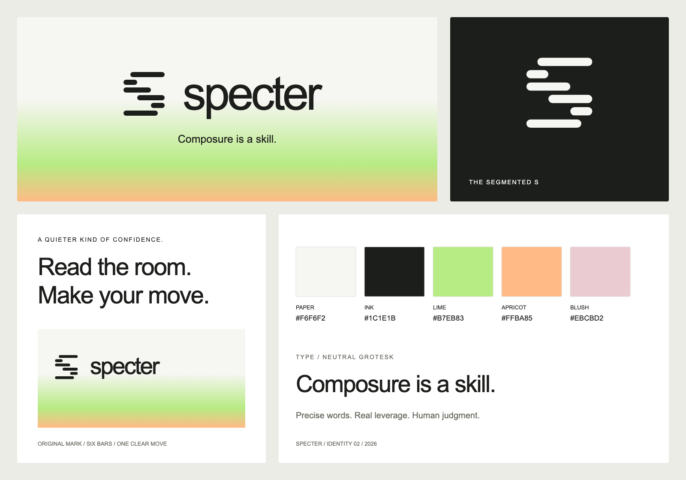

# SPECTER identity

A quiet visual identity for sharp judgment: warm paper, ink, a segmented S, and a soft spectral field. Display the wordmark as lowercase `specter`; keep `SPECTER` as the written product name and `harvey-specter` as the install identifier.

## Assets

- [Primary banner](../banner.png): finished 3:1 raster hero, with the wordmark and "Composure is a skill." built in.
- [Segmented S](mark.svg): original six-bar vector mark, including accessible title.
- [Horizontal lockup](lockup.svg): vector mark and lowercase wordmark on a transparent background.
- [Social cover SVG](social-preview.svg) and [PNG](social-preview.png): 1200 x 630 cover layout.
- [Identity sheet SVG](identity-sheet.svg) and [PNG](identity-sheet.png): overview of the actual mark, palette, lockups, and visual treatment.

## Palette and typography

| Role | Color |
| --- | --- |
| Paper | `#F6F6F2` |
| Ink | `#1C1E1B` |
| Lime | `#B7EB83` |
| Apricot | `#FFBA85` |
| Blush accent | `#EBCBD2` |

Use a neutral grotesk: Arial or Helvetica for portable text assets, regular weight with restrained tight spacing. Keep documentation typography native to its host. Functional text uses ink on paper; the gradient is a supporting field. Never use low-contrast pastel text for instructions or status.

The mark is six rounded horizontal bars with an asymmetric S rhythm. Preserve their relative placement. Its small internal spaces need at least 24px of height for a standalone mark. Leave clear space of at least one bar's width around the mark and half the mark's height around a lockup. Use monochrome ink on a light field; on ink, use paper. Do not stretch it, add outlines, rebuild it as an animal, or insert shadows.

The reference supplied by the project founder informed the restrained typography, generous space, and spectral color treatment. The segmented S is original; it is not the reference company's symbol. The banner was created with built-in Imagegen, using the original mark and the supplied image as composition/style references. The remaining SVG assets are original vector artwork. No font files or reference-company assets are distributed.

This visual change does not alter the skill's behavior, evaluation claims, or affiliation boundaries. Original assets follow the repository's MIT license; that does not grant rights to third-party trademarks or characters.
